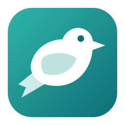
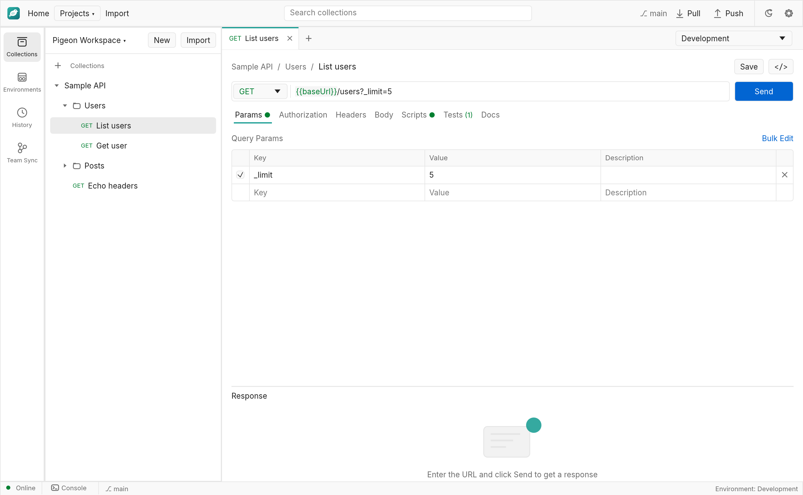

<p align="center">
  
</p>

<h1 align="center">Pigeon</h1>

<p align="center">
  A fast desktop API client whose collections are plain files, shared through git.<br>
  No account. No cloud. Your work stays in a folder you own.
</p>



## Why Pigeon

Most API clients keep your work in their own cloud and ask you to sign in. Pigeon keeps it in your project:

- **No account or cloud service.** Pigeon sends no usage data. It only contacts the servers you send requests to and
  your git remote.
- **Plain JSON files.** Each request is one small file, so teammates rarely conflict and changes read well in a diff.
- **Team sync through git.** Pull and Push from inside the app, using the git logins you already have.
- **A native app.** Written in Rust, it runs on macOS, Windows and Linux without a browser engine.

## Features

- Requests with parameters, headers, authorization and JSON, text, form or URL-encoded bodies
- Collections, folders, a collection runner and request history
- Environments and `{{variables}}`, with suggestions as you type
- JavaScript pre-request and post-response scripts using the `pm` API, in a sandbox with no file or process access
- Point-and-click response checks
- A console showing every call in full
- Code snippets for the current request
- Import from OpenAPI 3 JSON, v2.1 collection JSON and cURL
- Conflict help when two people change the same request

## Get started

Packaged builds for macOS, Windows and Linux are published on the [Releases](../../releases) page.

To build from source, install [rustup](https://rustup.rs) and [git](https://git-scm.com/downloads), clone this
repository, then run:

```sh
cargo run -p pigeon-app
```

The Rust version is pinned in `rust-toolchain.toml` and installs itself. Linux and Windows need a few extra system
packages, listed in the [build guide](docs/build.md).

New to Pigeon? The [user manual](docs/user-manual.md) walks through your first request.

## Sharing with your team

1. Put your project folder in a git repository, or join one your team already has.
2. Open **Team Sync** to see what changed.
3. Commit, then **Push**. Teammates **Pull** to get your work.

Project files aren't encrypted, so anyone who can read the repository can read tokens saved in requests and
environments. Keep secrets in globals or in variables set by scripts, which stay on your computer. See
[security](SECURITY.md) for details.

## Contributing

Contributions of every size are welcome: bug reports, fixes, documentation and new features.

```sh
cargo fmt --all
cargo clippy --workspace --all-targets --all-features -- -D warnings
cargo test --workspace
```

CI runs these on macOS, Windows and Linux, and any formatting difference or lint warning fails it. The `team_sync`
tests need a global git identity (`user.name` and `user.email`).

Read the [contributing guide](CONTRIBUTING.md) before opening a pull request, and the
[architecture guide](docs/architecture.md) before changing the code.

### Good places to start

These are the things Pigeon doesn't do yet:

- Uploading files in form-data bodies
- `require` in scripts (such as lodash, crypto-js or moment) and `pm.visualizer`
- OAuth sign-in flows
- Keeping cookies between requests
- OpenAPI files in YAML, and Swagger 2 files
- WebSocket, GraphQL and gRPC requests
- Drag and drop in the collection tree
- Automatic updates

## Documents

| Document | For |
| --- | --- |
| [User manual](docs/user-manual.md) | Everyone using Pigeon |
| [Scripting reference](docs/scripting-reference.md) | People writing scripts |
| [Troubleshooting](docs/troubleshooting.md) | When something goes wrong |
| [Build guide](docs/build.md) | Developers compiling and testing Pigeon |
| [Architecture](docs/architecture.md) | Developers changing the code |
| [Workspace format](docs/workspace-format.md) | Anyone reading or generating workspace files |
| [Distribution runbook](docs/distribution-runbook.md) | Whoever packages, signs and publishes releases |
| [Contributing](CONTRIBUTING.md), [Security](SECURITY.md), [Changelog](CHANGELOG.md) | Project information |

## Project layout

```text
crates/pigeon-core   Everything that doesn't need a window: requests, scripts, git, files
crates/pigeon-app    The desktop app
assets/fonts         The bundled fonts and their licenses
assets/icon          The icon, in every format the systems need
packaging            Recipes for the macOS, Windows and Linux packages
docs                 The documents above
.github/workflows    Automatic checks and release builds
```
